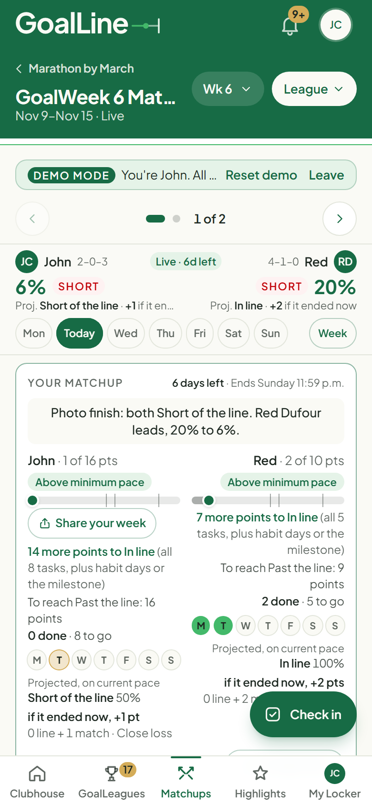
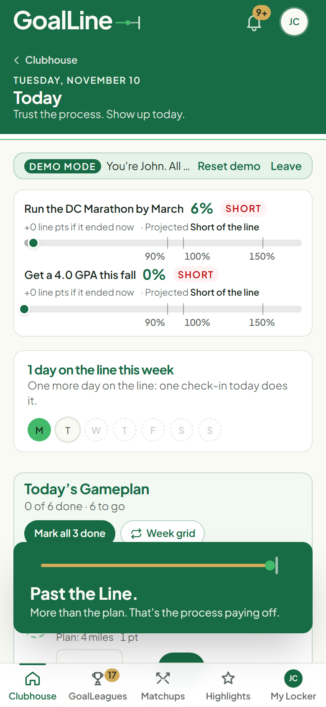
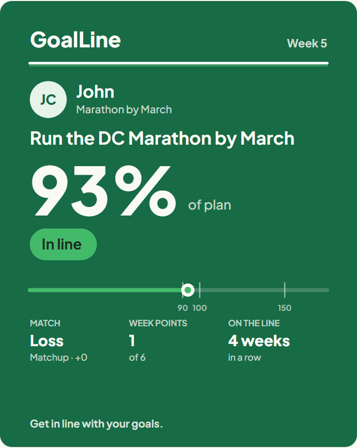
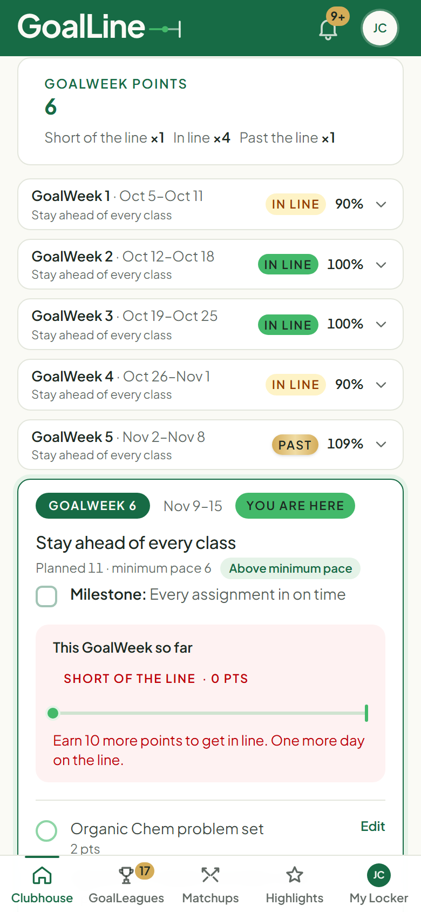

# GoalLine

[](https://github.com/RKuegler7/GoalLine/actions/workflows/tests.yml)

**A fantasy-sports-style accountability app: friends play their real goals head to head, one GoalWeek at a time.**

> **The 20-second pitch:** Every player is scored against their own plan by plain code, not AI. Big claims need proof or your opponent's sign-off, and plans can't drop below the minimum pace the deadline requires.

**Live app:** https://ddhxw7holo4vs.cloudfront.net

### Try the demo (no sign-up, no password)

1. Open https://ddhxw7holo4vs.cloudfront.net on your phone or laptop.
2. Tap **Try the demo**. You're signed in as John Cardinal, with your own private copy of a demo world: friends, two GoalLeagues in GoalWeek 6, and a live matchup. Everything is pretend, so tap anything.
3. Check off a task on **Today's Gameplan** and watch the band move. Open **Matchups** and swipe between matchups. Open the account menu, then **Your week**, then **Share your week**.
4. Tap **Reset demo** in the banner any time to start fresh.

**About GoalLine** (public): https://ddhxw7holo4vs.cloudfront.net/about: how to play, scoring (rendered from the same code that scores every week), fair play, the AI coach, privacy and FAQ.

**Demo video (2 to 3 minutes):** *(link coming)*

<table>
  <tr>
    <td align="center" width="25%"><br><sub><b>The GoalWeek Matchup</b></sub></td>
    <td align="center" width="25%"><br><sub><b>The band-up moment</b></sub></td>
    <td align="center" width="25%"><br><sub><b>A shareable weekly card</b></sub></td>
    <td align="center" width="25%"><br><sub><b>The plan, week by week</b></sub></td>
  </tr>
</table>

**Get in line with your goals. We get more done together.** GoalLine is about the process, not just the end result: the goal is what the daily work builds, and doing it with friends makes it stick. Trust the process. Show up today.

*Kuegs: CUA Busch School AI Vibe Coding Contest, Fall 2026*

## GoalLine on one page

**The problem.** Big goals with deadlines (the CPA exam, a spring marathon, a thesis) fail in the middle, not at the start. Motivation fades, nobody notices when you slip, and accountability apps either nag you alone or rank you against people with completely different goals.

**The solution.** GoalLine turns a goal into a season. An AI coach drafts a dated plan of GoalWeeks; each week you check in, and you play one friend in a fantasy-football-style matchup. You're never compared on raw numbers: each player is scored against their own plan, so a CPA candidate and a marathoner can play fairly in the same league. Proof, open check-ins, disputes and a minimum pace set by code keep it honest.

**How the AI does the work.** Claude writes the goal-specific intake questions, drafts the whole plan (focus, milestone, daily tasks and habits for every week), reads an uploaded syllabus or training plan, refines the plan from a request in your own words, and writes the weekly coach's tip. Plain, tested code does everything that has to be trusted: it sets the minimum pace, locks started weeks, scores every week and matchup, and holds disputed points. The AI never scores, never rules on a dispute and never gives medical advice. More in [docs/AI.md](docs/AI.md).

**What I learned.** The AI is best as a coach, not a referee: people trust the game only when the scoring is plain code they can read and test. Building in phases with a test suite that never went red let me change the scoring rules late (photo finishes, the 3-2-1-0 match points) without breaking anything. And real use beat my own assumptions every time: hands-on feedback is what turned page reloads into in-place updates, a static matchup screen into a swipeable pager, and a quiet demo into a one-click world anyone can try.

**Read more:** [Architecture](docs/ARCHITECTURE.md) · [How the AI is used](docs/AI.md) · [Fair play](docs/FAIRNESS.md) · [The rules as built](docs/SPEC.md) · [Decisions](docs/DECISIONS.md) · [Reliability](docs/RELIABILITY.md) · [Changelog](CHANGELOG.md)

## What the app does

1. **Set a goal** with a deadline (an exam, a race, a thesis, a job search). GoalLine asks 5 to 8 questions written for that goal, then the AI coach drafts a dated roadmap of GoalWeeks: a focus, a milestone and daily tasks, plus habits with clear rules like "Run · 2+ miles" on Mon, Wed, Fri.
2. **Check in every day** from Today's Gameplan or the Today page's week grid. Add a photo to show your work.
3. **Play it with friends** in a GoalLeague. Each GoalWeek you face one league mate in the **GoalWeek Matchup**, a fantasy-football-style pager: swipe between matchups, see both players' tasks day by day where the players would be, each side's band, its projected band on current pace, and the points each would take if the week ended now. Same band? It's a photo finish, settled by percent of plan.
4. **Keep it honest and keep it going**: open matchups, proof for big weeks, disputes, a minimum pace set by code, cheers and comments on posts, streaks, recaps, badges and season awards.

## Who it's for

Students and friend groups working toward real goals with real deadlines: classmates studying for the CPA, a running club training for a spring marathon, roommates chasing a 4.0, a writing group finishing drafts. Small leagues of people who know each other (12 or fewer works best).

## The AI: what it does and what it never does

GoalLine uses **Anthropic's Claude API**. The AI:

- writes goal-specific **intake questions** (what a coach would ask before planning);
- **drafts the roadmap** from the goal, the answers and any uploaded study or training plan;
- **refines the plan** when you ask in your own words ("Make weeks lighter, I have finals"), as a preview you accept or discard;
- checks your edits and gives an end-of-week **coach's tip**;
- optionally **suggests a caption** for a post, which you edit.

The AI **never scores** a week, **never decides a dispute**, **never sets the minimum pace**, and **never gives medical advice**. Scoring and fairness are plain, tested PHP.

## How the scoring works

Each GoalWeek, your share of your own planned points sets your band. A regular task is 1 point, each habit day 1, the milestone 2.

| Band | Share of your plan | Line points |
|---|---|---|
| Short of the Line | under 90% | 0 |
| In Line | 90% to 100% | 1 |
| Past the Line | over 100%, under 150% | 2 |
| Smashed the Line | 150% and up (needs proof or the opponent's OK) | 3 |

In a matchup a **higher band is a Win for 3** match points and a Loss for 0. The **same band is a Photo finish**: the higher credited percent of plan (whole number, held disputed points left out, unproven Smashed capped at 149%) takes a **Close win for 2** and the other a **Close loss for 1**; an exact tie is **1 each**. A week is worth 0 to 6 points (line points + match points). With an odd number of members, one person plays the league median.

## How fairness works

GoalLine doesn't police anyone. It makes cheating visible, hard to do quietly, and not worth much. The full plain-English version is in [docs/FAIRNESS.md](docs/FAIRNESS.md), and the exact rules are in [docs/SPEC.md](docs/SPEC.md).

- **Minimum pace (plan floor):** code sets each week's minimum planned points from the goal type, deadline and intake answers. Plans can be harder, never easier, so asking the AI for an easy plan doesn't work. Two lighter weeks a season are allowed, at 70%, with a reason the league sees.
- **Plan lock:** a week's plan locks when it starts. No removing work after seeing how the week is going.
- **Range checks:** numbers must be sensible, and unusually high ones get an "Are you sure?".
- **No backfill:** check-ins are for today or yesterday only.
- **Opponent visibility:** both sides' check-ins, times and plan status are open to the league.
- **Proof for Smashed:** a 150%+ week counts as Smashed only with a photo or the opponent's confirmation.
- **Disputes:** the opponent or league owner can dispute any check-in. Its points are held when the week closes until it's settled by proof, an explanation, a withdrawal or the league owner's ruling, and then the week re-scores on its own.

## What happens when the AI gets it wrong

- **Everything it returns is validated.** Malformed or incomplete answers are rejected, text is cleaned and capped, and only weeks that are allowed to change can be touched.
- **Nothing changes without you.** Refinements show a week-by-week preview with Accept and Discard, and a new plan is a draft until you accept it.
- **Fallbacks, not dead ends.** If the coach fails, times out or hits a spending cap, GoalLine uses built-in intake questions or a starter plan for the goal type, at the minimum pace, and says so plainly.
- **Plans stay yours.** You can edit, reorder and move tasks, edit focus and milestones, and restore any earlier version from plan history.
- **Code has the last word on workload.** If the AI plans below the minimum pace, code raises the week and tells you why.

## Safety and privacy

- Proof photos are re-encoded on the server, which strips location and camera data. They're served only to people allowed to see them (the owner, the opponent and the league owner, or wider if the member posts them).
- No GPS or maps. "Where?" is free text, with a reminder to crop out maps that show your home.
- People search shows only name, username and photo, never emails. A setting hides you from name search.
- Leagues are invite-only, posts can be reported, and plan summaries never show private notes, intake answers or reflections.
- AI spending is capped per member, per day and per month. The demo uses saved sample answers.
- **Disclaimer:** GoalLine plans are general guidance, not medical advice. Check with a doctor if you have health concerns. Physical goals always get an injury question, conservative progression and rest days.

## Run it on your computer

Needs PHP 8.4+, Composer and Node.

```bash
composer install
npm install
cp .env.example .env
php artisan key:generate
php artisan migrate --seed
composer run dev
```

Then open http://localhost:8000.

- `php artisan migrate --seed` builds the demo world. Sign in as **john.cardinal@demo.goalline.invalid** with the password **password**, or tap **Try the demo**. Running `php artisan db:seed` again replaces it with a fresh one dated to today. Demo worlds are deleted after 24 hours, so re-seed if it's gone.
- Without an `ANTHROPIC_API_KEY`, everything works and the coach uses its built-in fallbacks.
- Emails are written to `storage/logs/laravel.log` (`MAIL_MAILER=log`).
- Run the tests with `php artisan test --compact`. More in [Testing](#testing).

## Testing

**Unit and feature tests (PHPUnit).** `php artisan test --compact` runs 600+ tests (also on every push, by [GitHub Actions](.github/workflows/tests.yml)): scoring (every band boundary and the full matchup matrix, photo finishes, the 149% cap, held disputes), fair play, plan floor, the matchup pager and its projections, privacy of proof photos and posts, the demo, and mobile readiness.

**QA suite (Playwright).** `npm run qa` builds the assets, starts its own server on a fresh `database/qa.sqlite` (your local data is never touched), and clicks through the whole Try the demo script on three profiles: an **iPhone 14 (WebKit)**, a **small Android phone (Chromium)** and a **desktop (Chromium)**. The script: Try the demo, dashboard, a goal and its plan, check in a task, attach proof, the matchup pager (swipe between matchups), a task sheet, a dispute, a group-task vote, a friend request, Highlights, the inbox, My Locker and the privacy page.

On every screen and profile it checks for failed requests and 500s, console errors, horizontal overflow, tap targets under 44 px, text under 12 px, missing alt text or form labels, colour contrast (axe-core), and actions that reload the page or jump to the top. It writes:

- `qa/REPORT.md`: findings by severity (blocker, important, nice to have) with the screen, profile and a suggested fix, plus a checklist for a real iPhone. WebKit emulation is close to iPhone Safari, not the same.
- `qa/screenshots/<profile>/`: a full-page screenshot of every screen (git-ignored).

First time only: `npx playwright install chromium webkit`.

**UX reviewer agent.** `.claude/agents/ux-reviewer.md` is a read-only Claude Code reviewer. In Claude Code, ask: *"Use the ux-reviewer agent to review the app."* It runs `npm run qa`, reads the report and screenshots, and replies with prioritized feedback on clarity, flow, visual polish, mobile usability and tone, plus its top 5 fixes. It never edits code.

**Live checks.** `npm run smoke -- --url https://YOUR-ADDRESS` checks a running site end to end (health, home, Try the demo, a check-in, Matchups, privacy) and fails on any 500 or console error; it only uses a fresh demo account, so it's safe on production. On the server, `php artisan goalline:preflight` checks the production settings without printing secrets, and `/health` reports the database, cache, storage and queue for an uptime monitor. See [docs/RELIABILITY.md](docs/RELIABILITY.md).

## What we chose not to build

The full reasoning, including why things were built the way they were, is in [docs/DECISIONS.md](docs/DECISIONS.md).

- **No AI judging.** The AI never scores, never rules on disputes and never sets the minimum pace.
- **No GPS, maps or wearable syncing** (Strava, Apple Health). That's more privacy risk than a friendly league needs.
- **No money, stakes or betting**, and no public leaderboards or follower counts.
- **No public user directory.** People find each other by name, username or exact email, inside a private beta.
- **No medical advice**, and no diagnosing from intake answers.
- **No native apps.** GoalLine is an installable web app with push notifications.

## Known limitations

- Check-ins are self-reported. GoalLine makes faking visible and not worth much, but it can't prove someone studied for an hour.
- The minimum-pace formulas are deliberate, documented rules of thumb, not a model of every goal.
- Weeks follow each member's own time zone, so a league spread across time zones can see weeks close a few hours apart.
- When the coach rewords a task it moved between weeks, the refinement preview shows it as removed and added rather than moved. Its explanation says where the work went.
- One Elastic Beanstalk server, with a single queue worker and scheduler, sized for a private beta.

## Build status

| Phase | What | Status |
|---|---|---|
| A | Fair play, proof and Smashed confirmation | Done |
| B | Media posts, feeds, friends and cheers | Done |
| C | Group tasks with a league vote, personal tasks | Done |
| D | Demo seed, fairness docs, deploy checklist | Done |
| E | Goal-to-league flow, league invites, people search | Done |
| F | Goal-specific intake questions feeding the plan | Done |
| G | Refine the plan with prompts, preview, manual edits, plan history | Done |
| H | Objective recurring tasks, Today view, week grid | Done |
| I | Plan floor, plan lock, plan transparency, disputes | Done |
| J | One-click Try the demo with isolated, resettable accounts | Done |
| K | README, final checks and freeze readiness | Done |
| L | In-place interactions, animations and toasts | Done |
| — | Scoring: 3-2-1-0 match points with the photo finish | Done |
| M | Swipeable matchup pager with task view and projections | Done |
| N | iPhone and mobile polish | Done |
| O | Playwright QA suite and UX reviewer agent | Done |
| — | Deadlock fixes, email verification links, persistent app shell, Start flow | Done |
| P | Live band progression and the band-up celebration | Done |
| R | Branded loader, skeletons, empty states and error pages | Done |
| Q | Shareable weekly result cards | Done |
| — | Switches to pause outbound email and push | Done |
| S | Reliability, security and accessibility hardening | Done |
| T | Final README, architecture and AI docs, repo hygiene | Done |

Week by week, from the commit history: [CHANGELOG.md](CHANGELOG.md). The phase details are in [docs/NEXT_BUILD.md](docs/NEXT_BUILD.md) (A–D), [docs/NEXT_BUILD_2.md](docs/NEXT_BUILD_2.md) (E–H), [docs/NEXT_BUILD_3.md](docs/NEXT_BUILD_3.md) (I–K), [docs/NEXT_BUILD_4.md](docs/NEXT_BUILD_4.md) (L–O) and [docs/NEXT_BUILD_5.md](docs/NEXT_BUILD_5.md) (P–U).

## Deploying to Elastic Beanstalk

GoalLine runs on one Elastic Beanstalk server (PHP 8.4, Amazon Linux 2023). It uses an RDS MySQL database, a private S3 bucket for photos, Brevo for email, and CloudFront for HTTPS.

### Each deploy

1. Commit everything. If you changed any front-end files, run `npm run build` first and commit `public/build`.
2. Build the zip from the commit: `git archive --format=zip -o deploy.zip HEAD` (or `final-submission` for the judged version). Don't zip with Windows, which writes paths Linux can't read.
3. Elastic Beanstalk console → your environment → **Upload and deploy** → choose `deploy.zip`.
4. The server then does the rest on its own (`.platform/hooks/postdeploy/01-goalline.sh`). It checks the database connection, runs the migrations, gives existing plans their minimum pace (`goalline:plan-floors`), caches the config, and restarts the queue worker and the scheduler. There's no separate migrate step, and no seeders run on the server.
5. Check it: the deploy log (`eb-hooks.log`) shows `goalline:preflight` with PASS, WARN or FAIL per setting, `/health` should say `ok`, and from your computer `npm run smoke -- --url https://YOUR-ADDRESS` runs the live end-to-end check.

> **Photos need S3.** The server's own disk is wiped on every deploy. Until S3 is set up, uploaded photos (proof, posts, profile pictures, plan files) vanish on each deploy. The admin page's **Photo storage** card says whether S3 is working.

### Environment properties

Set these in Elastic Beanstalk → **Configuration** → **Updates, monitoring and logging** → **Environment properties**. Never put them in the repo.

| Setting | What to put |
|---|---|
| `APP_KEY` | From `php artisan key:generate --show` |
| `APP_URL` | The site's https address (the CloudFront one) |
| `DB_HOST`, `DB_DATABASE`, `DB_USERNAME`, `DB_PASSWORD` | The RDS database |
| `AWS_BUCKET`, `AWS_DEFAULT_REGION` | The S3 bucket name and `us-east-1`. Leave the AWS keys blank: the server's role grants access |
| `MAIL_HOST`, `MAIL_USERNAME`, `MAIL_PASSWORD`, `MAIL_FROM_ADDRESS` | Brevo: `smtp-relay.brevo.com`, your Brevo SMTP login and SMTP key, and your verified Brevo sender |
| `ANTHROPIC_API_KEY` | For the AI coach and caption suggestions |
| `VAPID_PUBLIC_KEY`, `VAPID_PRIVATE_KEY`, `VAPID_SUBJECT` | For phone push notifications |
| `ADMIN_EMAILS` | Who can open `/admin` |
| `GOALLINE_EMAIL_REMINDERS`, `GOALLINE_EMAIL_NUDGES`, `GOALLINE_EMAIL_RECAPS`, `GOALLINE_EMAIL_NOTIFICATIONS`, `GOALLINE_PUSH` | `true` to send that kind of email (or push). Each is off until set. Verification, password reset and emailed invites always send. See [docs/RELIABILITY.md](docs/RELIABILITY.md#turning-on-notifications) |

Already set by `.ebextensions/01-laravel.config`: `APP_ENV=production`, `APP_DEBUG=false`, MySQL, database sessions, cache and queue, secure session cookies, `UPLOADS_DISK=s3`, Brevo's port, `BETA_INVITE_ONLY=true` and `BEHIND_CLOUDFRONT=true`.

Optional, with sensible defaults: `ANTHROPIC_MODEL`, `ANTHROPIC_TIMEOUT` (600), `ANTHROPIC_MAX_RETRIES` (2), `ANTHROPIC_QUICK_TIMEOUT` (20), `MAIL_TIMEOUT` (15), `CONTACT_EMAIL`, `PROOF_DISK` (default `uploads`, the same S3 bucket), `CAPTION_SUGGESTIONS`, `DEMO_ENABLED`, `DEMO_TTL_HOURS` (24), `DEMO_LIVE_AI` (off: the demo uses saved sample answers), the AI caps (`AI_DAILY_REQUESTS_PER_MEMBER`, `AI_DAILY_BUDGET_USD`, `AI_MONTHLY_BUDGET_USD`) and the demo AI allowance (`DEMO_AI_REQUESTS_PER_VISITOR`, `DEMO_AI_REQUESTS_PER_DAY`).

### Setting up S3 for photos (one time)

1. **Make the bucket.** AWS console → **S3** → **Create bucket**.
   - Name it something like `goalline-uploads-kuegs`, in the region **US East (N. Virginia) us-east-1**.
   - Leave **ACLs disabled** and **Block all public access** turned on (both are the defaults). Photos stay private, and GoalLine shows them only to people allowed to see them.
   - Click **Create bucket**.
2. **Let the server use it.** AWS console → **IAM** → **Roles** → open **aws-elasticbeanstalk-ec2-role** → **Add permissions** → **Create inline policy** → **JSON**. Paste this, with your bucket name in place of `BUCKET`:

   ```json
   {
     "Version": "2012-10-17",
     "Statement": [
       { "Effect": "Allow", "Action": ["s3:ListBucket"], "Resource": "arn:aws:s3:::BUCKET" },
       { "Effect": "Allow", "Action": ["s3:GetObject", "s3:PutObject", "s3:DeleteObject"], "Resource": "arn:aws:s3:::BUCKET/*" }
     ]
   }
   ```

   Name the policy `goalline-uploads` and save it.
3. **Tell GoalLine the bucket.** In the Elastic Beanstalk environment properties, set `AWS_BUCKET` to the bucket name and `AWS_DEFAULT_REGION` to `us-east-1`. Leave `AWS_ACCESS_KEY_ID` and `AWS_SECRET_ACCESS_KEY` empty. Click **Apply** and wait for the environment to go green.
4. **Check it.** Open `/admin` on the live site. The **Photo storage** card should say S3 is working. Then post a check-in photo, deploy again, and make sure the photo is still there.

### Platform limits to set once

- An Anthropic Console spend limit, the real backstop behind GoalLine's own AI caps.
- An AWS Budget with email alerts.
