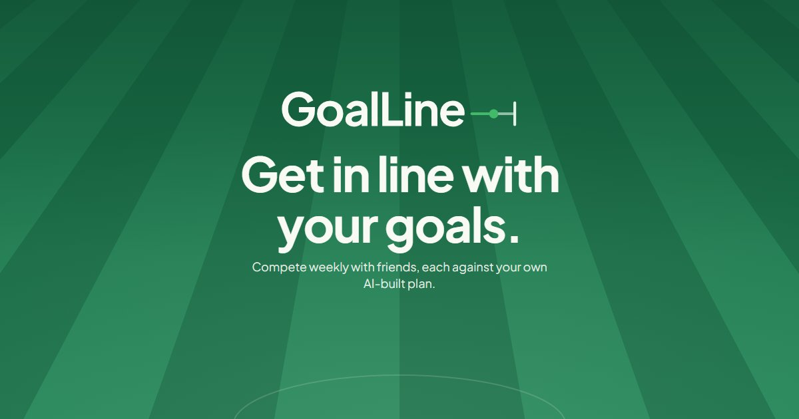
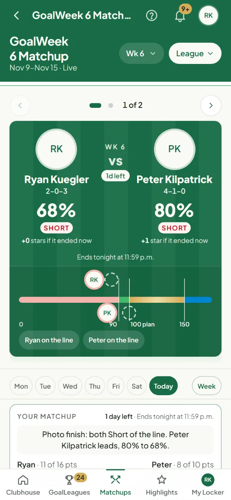
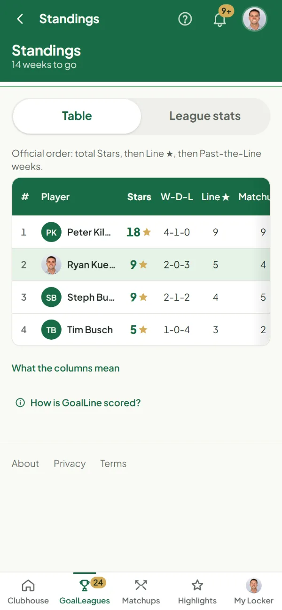
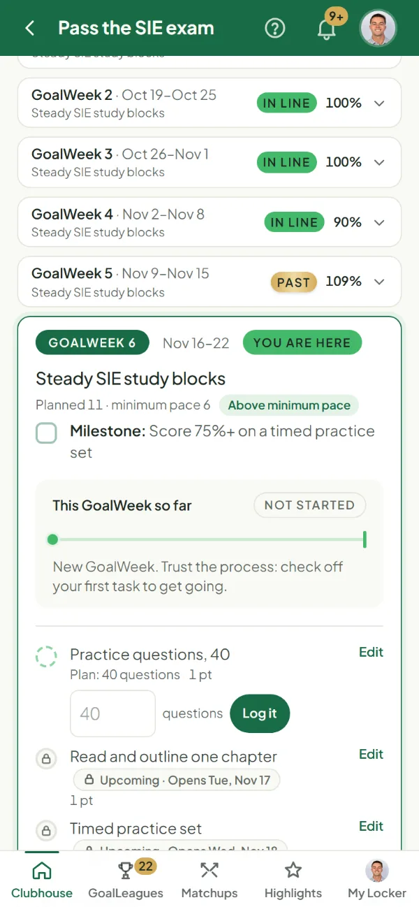

<p align="center"></p>

# GoalLine

[](https://github.com/RKuegler7/GoalLine/actions/workflows/tests.yml)

**Get in line with your goals: an app that helps you commit to a goal and actually finish it, through group accountability, a game you play every week, friendly competition and a quick daily check-in.**

**Live app:** https://ddhxw7holo4vs.cloudfront.net

**Try the demo:** open the live app and tap **Try the demo**. One tap, no sign-up, no password: you get your own private copy of a demo world with friends, GoalLeagues mid-season, a live Matchup and Challenges. **Reset demo** in the banner starts it fresh, and the **Judge's tour** pill lists six things worth trying.

**Demo video:** DEMO_VIDEO_LINK *(coming)*

> **The 20-second pitch:** Every player is scored against their own plan by plain code, not AI. Big claims need proof or your opponent's sign-off, and plans can't drop below the minimum pace the deadline requires.

<table>
  <tr>
    <td align="center" width="25%"><br><sub><b>Landing page</b></sub></td>
    <td align="center" width="25%"><br><sub><b>The weekly Matchup</b></sub></td>
    <td align="center" width="25%"><br><sub><b>Standings</b></sub></td>
    <td align="center" width="25%"><br><sub><b>The plan, week by week</b></sub></td>
  </tr>
</table>

*Kuegs: CUA Busch School AI Vibe Coding Contest, Fall 2026*

## The problem

Big goals with deadlines (the CPA exam, a spring marathon, a thesis) rarely fail at the start. They fade in the middle: motivation drops, progress is invisible, nobody notices a missed week, and nothing brings you back tomorrow. Accountability apps either nag you alone or rank you against people with completely different goals, which isn't fair and isn't fun.

## What GoalLine does

GoalLine was created to help people commit to their goals and actually accomplish them. It turns a goal into a season:

1. **Set a goal** with a deadline. GoalLine asks 5 to 8 questions written for that goal, and the AI coach drafts a dated plan of **GoalWeeks**: a focus, a milestone, daily tasks and habits with clear rules ("Run · 2+ miles" on Mon, Wed, Fri).
2. **Check in every day** from Today's Gameplan, the Today page or the floating **Check in** button. Add a photo or a few details to show your work.
3. **Play it with friends** in a **GoalLeague**. Each GoalWeek you face one league mate in the **Matchup**, scored against your own plans, so a CPA candidate and a marathoner play fairly in the same league. The **Standings** table ranks the season by stars.
4. **Take on a Challenge**: one simple rule for a set time, done together (see [Challenges](#challenges)).
5. **Keep it going**: posts and cheers in **Highlights**, streaks, weekly recaps, badges, medals, a season finale, and friends' profiles.

Four things do the motivating: **group accountability** (your league sees your check-ins), **goals as a game** (stars, streaks, badges and medals), **friendly competition** (the weekly Matchup) and **a daily habit** (one quick check-in keeps the goal in front of you).

## Who it's for

Students and friend groups working toward real goals with real deadlines: classmates studying for the CPA, a running club training for a spring marathon, roommates chasing a 4.0, a writing group finishing drafts, a parish group keeping Lent. Small leagues of people who know each other work best (12 or fewer); Challenges can be bigger.

## How the AI works

GoalLine uses **Anthropic's Claude API** for the parts where judgment and language help:

- **Intake questions:** a few questions written for your goal, the way a coach would start (built-in questions stand in if the AI is unavailable).
- **Drafting the plan:** the whole season of GoalWeeks from your goal, your answers and any uploaded syllabus or training plan.
- **Refining the plan:** ask in your own words ("Make weeks lighter, I have finals"); you get a week-by-week preview to accept or discard. Every version is kept.
- **Coaching:** an end-of-week tip, a check on your own edits, ideas for your next goal, and an optional caption suggestion you edit.
- **The recap narrator:** two or three sentences about your finished week, written only from numbers code counted (an answer with any other number is replaced by a plain template).

Every goal page has a **"How this plan was built"** panel showing, for that plan, what the AI did (one real intake question, its explanation) and what code enforced (the dates, the weeks raised to the minimum pace and by how much, when each week locked, the AI caps).

**What the AI never does:** it never scores a week, never decides a Matchup or a dispute, never sets the minimum pace, and never gives medical advice. Scoring and fairness are plain, tested PHP. More in [docs/AI.md](docs/AI.md).

## What happens when the AI gets it wrong

- **Everything it returns is validated.** Malformed or incomplete answers are rejected, text is cleaned and capped, the weeks must match the dates code set, and only weeks that are allowed to change can be touched.
- **Preview and accept.** A new plan is a draft until you accept it; refinements show a preview with Accept and Discard.
- **The plan floor.** If the AI plans below the minimum pace the deadline needs, code raises the week and tells you why.
- **Fallbacks, not dead ends.** If the coach fails, times out or hits a spending cap, built-in intake questions or a starter plan for the goal type stand in, and the app logs a counted warning (`php artisan goalline:ai-check` tests the key in plain English).
- **Cached demo responses.** Demo accounts use saved sample answers, so judges never trigger live AI calls or spend.

## How scoring works

Each GoalWeek, your share of your own plan sets your **band**, and the week is worth **0 to 5 stars**: line stars (0 to 3) plus matchup stars (0 to 2).

| Band | Share of your plan | Line stars |
|---|---|---|
| Short of the Line | under 90% | 0 |
| In Line | 90% to 100% | 1 |
| Past the Line | over 100%, under 150% | 2 |
| Smashed the Line | 150% and up (needs proof or the opponent's OK) | 3 |

| Matchup result | Matchup stars |
|---|---|
| Win (a higher band) | 2 |
| Photo finish win (same band, higher credited percent, compared exactly) | 1 |
| Tie (exactly equal percents) | 1 each |
| Loss | 0 |

More stars wins the Matchup and equal stars is a draw (W-D-L). A bye week earns line stars only. The table is ordered by **Stars**, then **Line ★**, then **Past-the-Line weeks**. Every value lives in one config (`config/goalline.php`), and the "How is GoalLine scored?" sheet in the app is rendered from the same code.

## How fairness works

GoalLine makes cheating visible, hard to do quietly, and not worth much. The plain-English version is [docs/FAIRNESS.md](docs/FAIRNESS.md); the exact rules are [docs/SPEC.md](docs/SPEC.md).

- **Minimum pace (plan floor):** code sets each week's minimum from the goal type, deadline and answers. Plans can be harder, never easier. Two lighter weeks a season are allowed, at 70%, with a reason the league sees.
- **Plan lock:** a week's plan locks when it starts.
- **No check-ins before kickoff, no backfill:** today or yesterday only, enforced on the server.
- **Range checks:** numbers must be sensible, and unusual ones get an "Are you sure?".
- **Open check-ins:** both sides' check-ins, times and plan status are visible to the league.
- **Proof for Smashed:** a 150%+ week counts as Smashed only with a photo or the opponent's confirmation.
- **Disputes:** the opponent or league owner can question a check-in; its points are held until it's settled by proof, an explanation, a withdrawal or the owner's ruling. People decide, never the AI.

## Challenges

A **Challenge** is one simple rule for a set time, done together, in Championship Gold. Start one from a template (Lent, a 75-day discipline checklist, 10,000 steps a day, a dry month and more) or build your own:

- **Four types:** Daily (a checklist), Weekly (X times a week or on chosen days), Abstain (stay off something; "Stayed on track" or a kindly worded "Slipped today") and Target (a number per day or week, range-checked).
- **Durations:** 7, 30, 40, 75 or 365 days, a calendar month, Lent (worked out from the date of Easter, with Sundays off), or custom dates up to 400 days. Kickoff is 12:00 a.m. New York time, and the rules lock then.
- **Strict or flexible:** strict restarts your streak on a miss; flexible allows 0 to 10 misses first.
- **Ranked by completion, never stars,** in a gold Standings table (Completion %, then current streak, then completed). Challenges never change GoalLeague Standings.
- **Fair play:** server-side date rules, same-day proof photos for the Verified check, and disputes the owner decides.
- **Public or private, side Challenges:** Private by default; public ones show up under "Find a public Challenge" in the GoalLeagues tab and in Explore. A GoalLeague owner can start a side Challenge just for that league.

## Safety, privacy and legal

- [Privacy Policy](https://ddhxw7holo4vs.cloudfront.net/privacy) · [Terms of use](https://ddhxw7holo4vs.cloudfront.net/terms) · [Community guidelines](docs/COMMUNITY_GUIDELINES.md) · [Accessibility statement](docs/ACCESSIBILITY.md)
- Photos are re-encoded on the server, which strips location and camera data, and are served only to people allowed to see them. No GPS or maps.
- People search shows only name, username and photo, never emails. A private account shows only its header (photo, name, @username, bio and counts) so friends can find you; goals, posts and stats stay hidden.
- GoalLeagues and Challenges are Private by default; posts are never Public unless you choose it. Posts can be reported, and people can be muted.
- Demo worlds are sealed off from real members: a demo visitor can't see, find or join anything real, never sends email and never calls the live AI.
- AI spending is capped per member, per day and per month.
- **Disclaimer:** GoalLine plans are general guidance, not medical advice. Physical goals always get an injury question, conservative progression and rest days.

## Accessibility and performance

**Accessibility.** axe-core (WCAG 2.1 A and AA) runs on every screen of the Try the demo script on an iPhone (WebKit), a small Android phone and a desktop, plus dedicated checks on the landing page, the Standings and Challenge tables, the profile header and the colour-matched tabs. Serious and critical findings: none on the screens checked. Tap targets are at least 44 × 44 px on phones, text at least 11 px (13 px for reading), tables have captions, row headers and `aria-sort`, sheets close with Escape and Back and return focus, and reduced motion turns off animations. Full statement: [docs/ACCESSIBILITY.md](docs/ACCESSIBILITY.md).

**Performance** (Lighthouse, mobile, measured on the QA laptop's one-request-at-a-time development server, which doesn't compress, so the live site is faster):

| Page | Performance | Accessibility | Best practices | SEO |
|---|---|---|---|---|
| Landing | 87 | 100 | 100 | 100 |
| Dashboard | 100 | 97 | 100 | 100 |
| Matchup | 90 | 100 | 100 | 100 |
| Standings | 98 | 100 | 100 | 100 |

The dashboard's 97 is one text link inside a sentence, which WCAG exempts from the target-size rule. Fonts are self-hosted with `font-display: swap`; landing images are 600 px WebP with sizes set (layout shift 0); CloudFront compresses responses. Not done: splitting the app's JavaScript for the landing page.

## Architecture

Laravel 13 (PHP 8.4), Blade with Tailwind CSS v4 and light JavaScript (Turbo Drive for the app shell, small modules for live updates and sheets), MySQL on RDS, S3 for photos, CloudFront for HTTPS, one Elastic Beanstalk server with a queue worker and scheduler. The diagram and the map of services are in [docs/ARCHITECTURE.md](docs/ARCHITECTURE.md); the reasoning behind the choices is in [docs/DECISIONS.md](docs/DECISIONS.md); operations are in [docs/RELIABILITY.md](docs/RELIABILITY.md).

## Testing

[](https://github.com/RKuegler7/GoalLine/actions/workflows/tests.yml)

- **PHPUnit:** `php artisan test --compact` runs about 880 tests, also on every push by [GitHub Actions](.github/workflows/tests.yml): every band boundary and the full Matchup matrix, photo finishes, held disputes, the plan floor, kickoff rules, Challenge completion for every type and mode, Lent dates, privacy of photos, posts and profiles, demo isolation, query budgets and mobile readiness.
- **Playwright QA suite:** `npm run qa` builds the assets, starts its own server on a fresh `database/qa.sqlite` (your local data is never touched) and clicks through the app on an **iPhone 14 (WebKit)**, a **small Android phone** and a **desktop**: the whole Try the demo script, the Standings table, Challenges for each type, public lists, the landing page, the Judge's tour, profiles and more. On every screen it checks for 500s, console errors, sideways scroll, small tap targets and text, cut-off text, contrast (axe-core) and full page reloads where an in-place update is expected, and writes `qa/REPORT.md`. Run a single file with `QA_PORT=8124 npx playwright test qa/e2e/challenges.spec.js`. First time only: `npx playwright install chromium webkit`.
- **Live checks:** `npm run smoke -- --url https://YOUR-ADDRESS` checks a running site with a fresh demo account; `php artisan goalline:preflight` checks production settings without printing secrets; `/health` reports the database, cache, storage, queue and the build stamp.

## How to run locally

Needs PHP 8.4+, Composer and Node.

```bash
composer install
npm install
cp .env.example .env
php artisan key:generate
php artisan migrate --seed
composer run dev
```

Then open http://localhost:8000 and tap **Try the demo**, or sign in as **john.cardinal@demo.goalline.invalid** with the password **password** (`php artisan db:seed` rebuilds that world, dated to today). Without an `ANTHROPIC_API_KEY` everything works and the coach uses its built-in fallbacks. Emails go to `storage/logs/laravel.log`.

## What testers said

TESTER_QUOTES

## Built with AI

I built GoalLine with **Claude Code**, from phased prompts that I wrote. I wrote the rules and specs myself (the scoring, the fairness rules, the brand and what the AI may and may not do), had each phase built against them, and tested every phase before moving on: the PHP test suite and the Playwright QA suite had to pass, and I tried each build by hand on my phone. The build log is the series of prompts in [docs/NEXT_BUILD.md](docs/NEXT_BUILD.md), [docs/NEXT_BUILD_2.md](docs/NEXT_BUILD_2.md), [docs/NEXT_BUILD_3.md](docs/NEXT_BUILD_3.md), [docs/NEXT_BUILD_4.md](docs/NEXT_BUILD_4.md) and [docs/NEXT_BUILD_5.md](docs/NEXT_BUILD_5.md), with week-by-week results in [CHANGELOG.md](CHANGELOG.md) and the full commit history on GitHub.

## What we chose not to build

The reasoning is in [docs/DECISIONS.md](docs/DECISIONS.md).

- **No AI judging.** The AI never scores, never rules on disputes and never sets the minimum pace.
- **No GPS, maps or wearable syncing** (Strava, Apple Health): more privacy risk than a friendly league needs.
- **No money, stakes or betting**, and no global leaderboard ranking strangers against each other.
- **No public user directory.** People find each other by name, username or exact email; public listings are only for GoalLeagues and Challenges their owners chose to make public.
- **No medical advice**, and no diagnosing from intake answers.

## What's next

- **Push notifications** for everyone: built and tested, behind the existing `GOALLINE_PUSH` flag, off in production until the reminder schedule is tuned.
- **A native iPhone wrapper** around the installable web app.
- **One-way follows** for public people, alongside mutual friends.
- **Identity federation for API credentials**, so the server's keys come from the cloud provider instead of environment properties.
- **The recap narrator for whole seasons** (it already narrates each finished week).

## Known limitations

- Check-ins are self-reported. GoalLine makes faking visible and not worth much, but it can't prove someone studied for an hour.
- The minimum-pace formulas are deliberate, documented rules of thumb, not a model of every goal.
- GoalWeeks follow each member's own time zone, while Challenges and GoalLeague kickoffs use New York time, so people far from Eastern time can see days close a few hours apart.
- When the coach rewords a task it moved between weeks, the refinement preview shows it as removed and added rather than moved.
- The Lighthouse numbers above come from a development server, not the live site.
- One Elastic Beanstalk server, with a single queue worker and scheduler, sized for a private beta.

## Deploying to Elastic Beanstalk

GoalLine runs on one Elastic Beanstalk server (PHP 8.4, Amazon Linux 2023). It uses an RDS MySQL database, a private S3 bucket for photos, Brevo for email, and CloudFront for HTTPS.

### Each deploy

1. Commit everything. If you changed any front-end files, run `npm run build` first and commit `public/build`.
2. Build the zip from the commit: `php artisan goalline:deploy-zip` (or `php artisan goalline:deploy-zip final-submission` for the judged version). It runs `git archive` (only committed files, Linux-friendly paths; don't zip with Windows) and adds the **build stamp**, `build.json`: the short commit hash and the build time, nothing secret.
3. Elastic Beanstalk console → your environment → **Upload and deploy** → choose `deploy.zip`.
4. The server then does the rest on its own (`.platform/hooks/postdeploy/01-goalline.sh`). It checks the database connection, runs the migrations, gives existing plans their minimum pace (`goalline:plan-floors`), caches the config, and restarts the queue worker and the scheduler. There's no separate migrate step, and no seeders run on the server.
5. Check it: the deploy log (`eb-hooks.log`) shows `goalline:preflight` with PASS, WARN or FAIL per setting, `/health` should say `ok`, and from your computer `npm run smoke -- --url https://YOUR-ADDRESS` runs the live end-to-end check.
6. Confirm the live site is the commit you meant: the bottom of the About page says **Build `abc1234` · built …** (linking to that commit on GitHub), and `/health` returns the same under `build`. A copy run straight from git says "running from source".

> **Photos need S3.** The server's own disk is wiped on every deploy. Until S3 is set up, uploaded photos (proof, posts, profile pictures, plan files) vanish on each deploy. The admin page's **Photo storage** card says whether S3 is working.

### Environment properties

Set these in Elastic Beanstalk → **Configuration** → **Updates, monitoring and logging** → **Environment properties**. Never put them in the repo.

| Setting | What to put |
|---|---|
| `APP_KEY` | From `php artisan key:generate --show` |
| `APP_URL` | The site's https address (the CloudFront one) |
| `DB_HOST`, `DB_DATABASE`, `DB_USERNAME`, `DB_PASSWORD` | The RDS database |
| `AWS_BUCKET`, `AWS_DEFAULT_REGION` | The S3 bucket name and `us-east-1`. Leave the AWS keys blank: the server's role grants access |
| `MAIL_HOST`, `MAIL_USERNAME`, `MAIL_PASSWORD`, `MAIL_FROM_ADDRESS` | Brevo: `smtp-relay.brevo.com`, your Brevo SMTP login and SMTP key, and your verified Brevo sender |
| `ANTHROPIC_API_KEY` | For the AI coach and caption suggestions |
| `VAPID_PUBLIC_KEY`, `VAPID_PRIVATE_KEY`, `VAPID_SUBJECT` | For phone push notifications |
| `ADMIN_EMAILS` | Who can open `/admin` |
| `GOALLINE_EMAIL_REMINDERS`, `GOALLINE_EMAIL_NUDGES`, `GOALLINE_EMAIL_RECAPS`, `GOALLINE_EMAIL_NOTIFICATIONS`, `GOALLINE_PUSH` | `true` to send that kind of email (or push). Each is off until set. Verification, password reset and emailed invites always send. See [docs/RELIABILITY.md](docs/RELIABILITY.md#turning-on-notifications) |

Already set by `.ebextensions/01-laravel.config`: `APP_ENV=production`, `APP_DEBUG=false`, MySQL, database sessions, cache and queue, secure session cookies, `UPLOADS_DISK=s3`, Brevo's port, `BETA_INVITE_ONLY=true` and `BEHIND_CLOUDFRONT=true`.

Optional, with sensible defaults: `ANTHROPIC_MODEL`, `ANTHROPIC_TIMEOUT` (600), `ANTHROPIC_MAX_RETRIES` (2), `ANTHROPIC_QUICK_TIMEOUT` (20), `MAIL_TIMEOUT` (15), `CONTACT_EMAIL`, `PROOF_DISK` (default `uploads`, the same S3 bucket), `CAPTION_SUGGESTIONS`, `DEMO_ENABLED`, `DEMO_TTL_HOURS` (24), `DEMO_LIVE_AI` (off: the demo uses saved sample answers), the AI caps (`AI_DAILY_REQUESTS_PER_MEMBER`, `AI_DAILY_BUDGET_USD`, `AI_MONTHLY_BUDGET_USD`) and the demo AI allowance (`DEMO_AI_REQUESTS_PER_VISITOR`, `DEMO_AI_REQUESTS_PER_DAY`).

### Setting up S3 for photos (one time)

1. **Make the bucket.** AWS console → **S3** → **Create bucket**.
   - Name it something like `goalline-uploads-kuegs`, in the region **US East (N. Virginia) us-east-1**.
   - Leave **ACLs disabled** and **Block all public access** turned on (both are the defaults). Photos stay private, and GoalLine shows them only to people allowed to see them.
   - Click **Create bucket**.
2. **Let the server use it.** AWS console → **IAM** → **Roles** → open **aws-elasticbeanstalk-ec2-role** → **Add permissions** → **Create inline policy** → **JSON**. Paste this, with your bucket name in place of `BUCKET`:

   ```json
   {
     "Version": "2012-10-17",
     "Statement": [
       { "Effect": "Allow", "Action": ["s3:ListBucket"], "Resource": "arn:aws:s3:::BUCKET" },
       { "Effect": "Allow", "Action": ["s3:GetObject", "s3:PutObject", "s3:DeleteObject"], "Resource": "arn:aws:s3:::BUCKET/*" }
     ]
   }
   ```

   Name the policy `goalline-uploads` and save it.
3. **Tell GoalLine the bucket.** In the Elastic Beanstalk environment properties, set `AWS_BUCKET` to the bucket name and `AWS_DEFAULT_REGION` to `us-east-1`. Leave `AWS_ACCESS_KEY_ID` and `AWS_SECRET_ACCESS_KEY` empty. Click **Apply** and wait for the environment to go green.
4. **Check it.** Open `/admin` on the live site. The **Photo storage** card should say S3 is working. Then post a check-in photo, deploy again, and make sure the photo is still there.

### Platform limits to set once

- An Anthropic Console spend limit, the real backstop behind GoalLine's own AI caps.
- An AWS Budget with email alerts.
