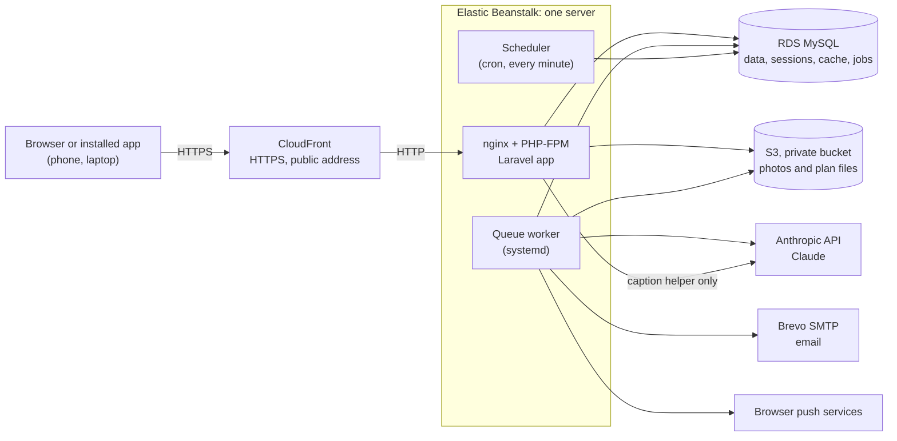
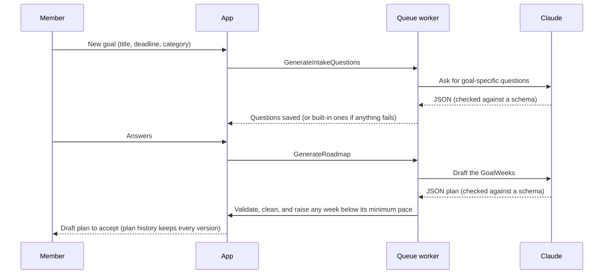

# Architecture

GoalLine is one Laravel 13 app (PHP 8.4) with server-rendered Blade pages and a little JavaScript. There's no separate API or front-end framework: Turbo Drive swaps pages in place, and small modules (`resources/js`) make forms update without reloads.

## The pieces

- **CloudFront** gives the site its HTTPS address. Every link and signed URL is built from `APP_URL`, so they're always on the public https address (`App\ShareLink`, `UsePublicAddress`).
- **One Elastic Beanstalk server** runs the web app, a queue worker and the scheduler. `.platform/hooks/postdeploy/01-goalline.sh` sets them up on every deploy and runs the migrations and `goalline:preflight`.
- **RDS MySQL** holds everything, including sessions, the cache and the job queue, so nothing is lost when Beanstalk replaces the server.
- **S3** stores proof photos, post photos, avatars and uploaded plans, privately. The app serves them through its own routes after checking who is asking.
- **Brevo** sends email. **Anthropic's API** is the AI coach. **Web push** goes through each browser's own push service.

## Main flows

**Planning a goal (AI drafts, code decides the workload).**

**Checking in (plain code end to end).** A tap on a task sends a live form (`resources/js/live.js`). `CheckInController` saves it inside `App\Atomic` (retried on deadlocks), `BandProgress` works out the new percent, band and points from the scoring code, and the page swaps in the updated regions without a reload. If the band went up, `celebrate.js` plays the band-up moment. Re-scoring that touches other people (disputes, league tables) runs afterwards as the `RescoreCheckIn` job.

**Settling a week.** Every hour `goalline:settle-leagues` locks finished GoalWeeks, scores each matchup (`LeagueTable`, `GoalWeekResult`, `MatchupOutcome`), stores `league_results`, posts recaps and awards badges. Points held by an open dispute are left out until it's settled; then the week re-scores itself.

**Notifications.** Every notification goes through `GoalLineNotification`, which always writes the Inbox copy and asks `App\Outbound` whether email (or push) is allowed. Each kind of email has an on/off switch (`GOALLINE_EMAIL_*`), and demo accounts never get email.

**Sharing a week.** "Share your week" freezes a snapshot of the week's result from the scoring code (`ResultCardData`) and draws it as SVG, or as a PNG with GD and the bundled fonts (`App\Services\ResultCards`). It can be posted to Highlights, shared, downloaded, or opened to anyone with an unguessable, revocable link.

**Try the demo.** `/demo` builds a private, throwaway world for each visitor (`DemoWorld`): made-up friends, two GoalLeagues mid-season, live matchups. The coach uses saved sample answers (`DemoCoach`), no email goes out, and the world deletes itself after 24 hours.

## What is AI and what is plain code

| Part | Done by | Where |
|---|---|---|
| Intake questions for a goal | **AI** (built-in questions if it fails) | `GenerateIntakeQuestions`, `RoadmapPlanner::intakeQuestions`, `IntakeQuestions` |
| Drafting the GoalWeek plan | **AI** (a starter plan if it fails) | `GenerateRoadmap`, `RoadmapPlanner::plan`, `FallbackPlan` |
| Reading an uploaded study or training plan | **AI** | `ReadPlanMaterial` |
| Refining a plan from the member's own words | **AI**, as a preview to accept or discard | `RefinePlan`, `PlanRefinement` |
| Checking manual plan edits, weekly coach tip | **AI** | `ReviewRoadmapChanges`, `CoachWeekReview` |
| Caption suggestion for a post (optional) | **AI**, edited by the member | `CaptionWriter` |
| Finished-week recap summary | **AI** words code's numbers; rejected if it adds a number (template if so) | `RecapNarrator`, `NarrateRecap` |
| "What the AI did, what code did" panel | **Code**, from the goal's history | `AiCodeSplit` |
| Minimum pace for each week (plan floor) | **Code** | `PlanFloor` |
| Plan lock, plan history, what can still change | **Code** | `PlanEditor`, `PlanVersion` |
| Points, bands, credited percent, Smashed proof rule | **Code** | `GoalWeekResult`, `RoadmapWeek` |
| Matchups, photo finishes, byes, league tables | **Code** | `LeagueTable`, `MatchupOutcome`, `MatchupBoard`, `MatchupPager` |
| Disputes and held points | **Code**, ruled by people | `Disputes` |
| Fair play limits (no backfill, range checks) and who sees check-ins | **Code** | `CheckInController`, `HabitController`, `RoadmapTask`, `FairPlay` |
| AI spending caps | **Code** | `AiBudget` |
| Share cards | **Code** | `ResultCardData`, `ResultCards` |
| Demo coach | **Saved samples**, no live AI | `DemoCoach` |

More on each AI job, its checks and its fallbacks: [AI.md](AI.md). Reliability and security: [RELIABILITY.md](RELIABILITY.md). The rules as built: [SPEC.md](SPEC.md) and [FAIRNESS.md](FAIRNESS.md).

## Where things live

- `app/Services`: the domain logic, each class doing one job (scoring, planning, matchups, recaps, demo).
- `app/Http/Controllers`: thin controllers. Authorization lives in `app/Policies` and route `can:` checks.
- `app/Jobs`: everything slow or AI-backed runs on the queue, after the database commit.
- `app/Console/Commands` and `routes/console.php`: the scheduled jobs (reminders every 15 minutes, settling leagues hourly, closing group-task votes, pruning demos) and `goalline:preflight`.
- `resources/views`: Blade pages and components (`components/`), one shared layout for the app shell.
- `resources/js`: `shell.js` (Turbo app shell), `live.js` (in-place forms), `celebrate.js`, `loader.js`, `cards.js`.
- `tests/Feature`: 600+ PHPUnit tests. `qa/`: the Playwright suite, the smoke test and the QA report.
